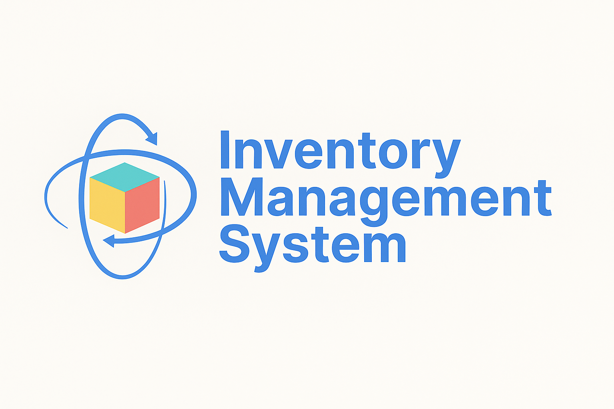
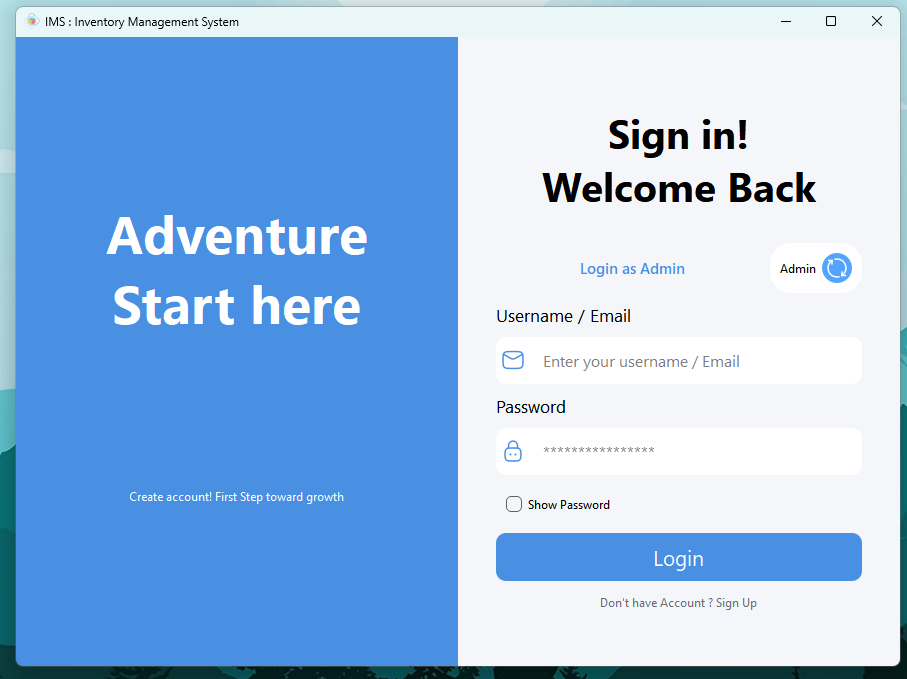
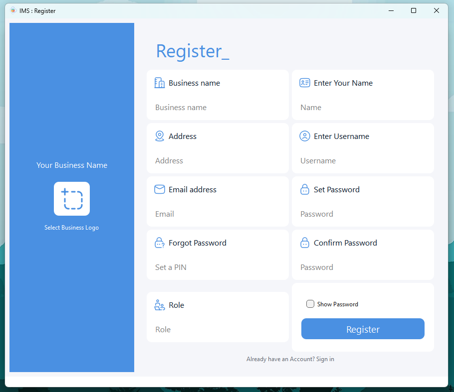
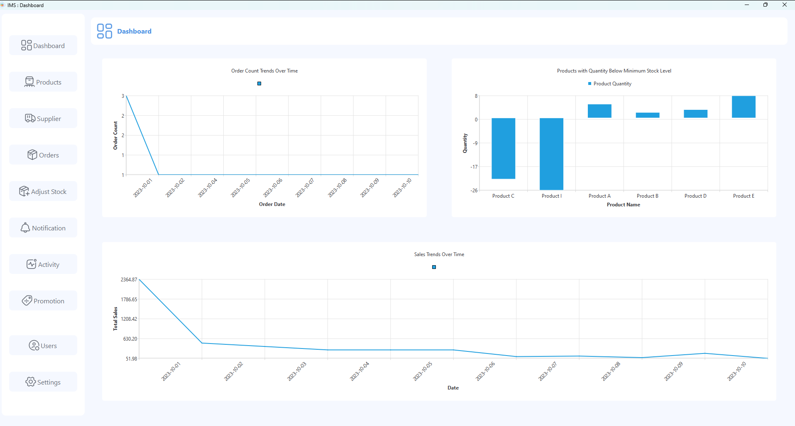
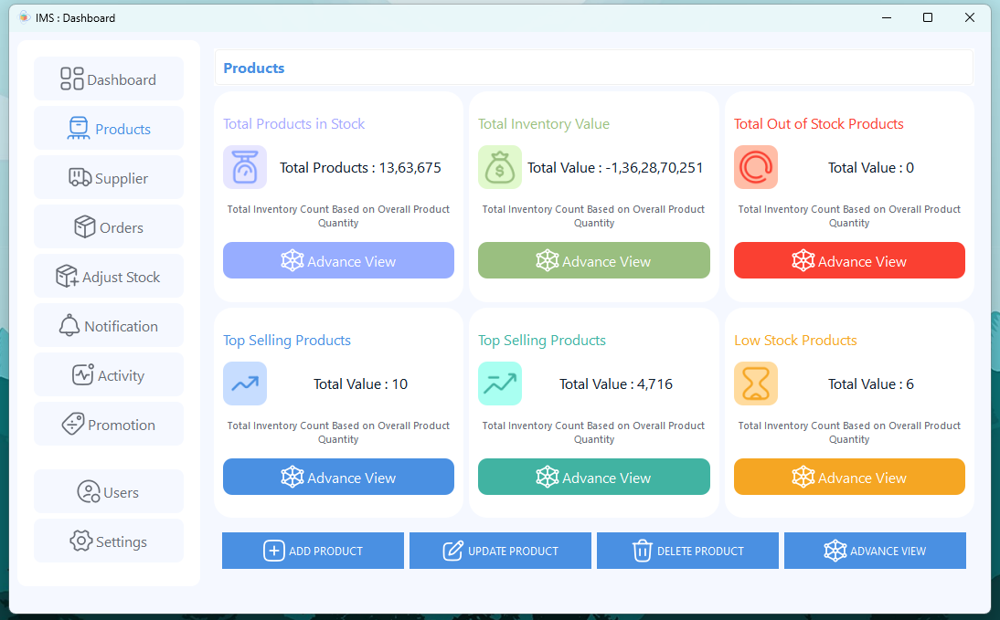
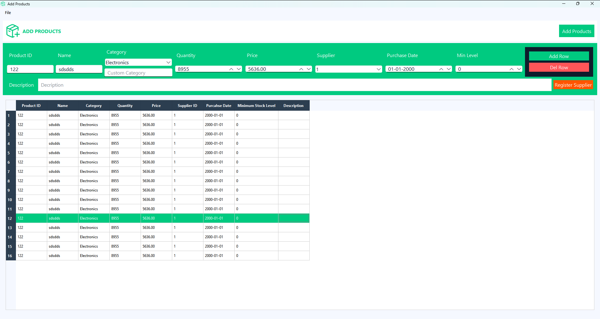
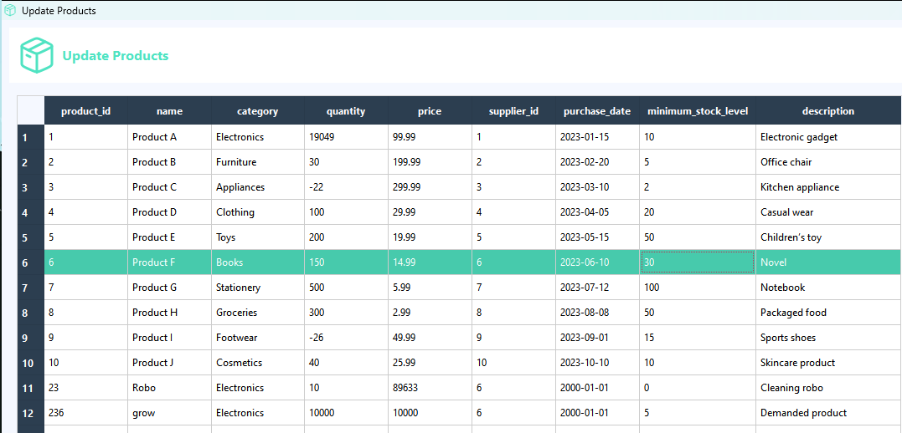
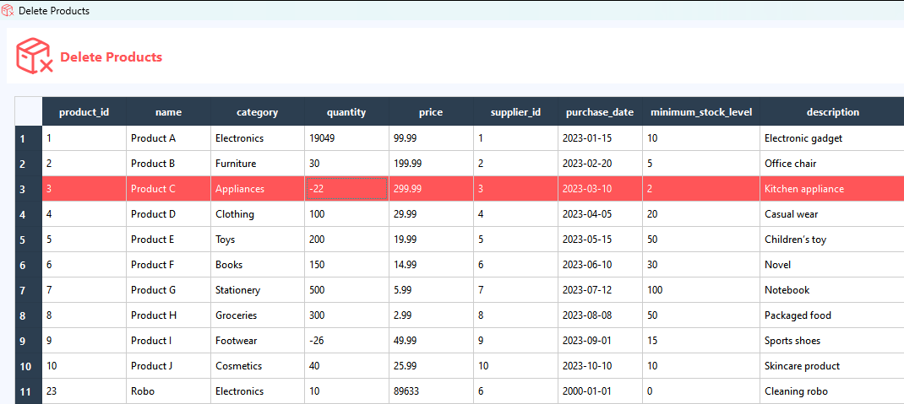
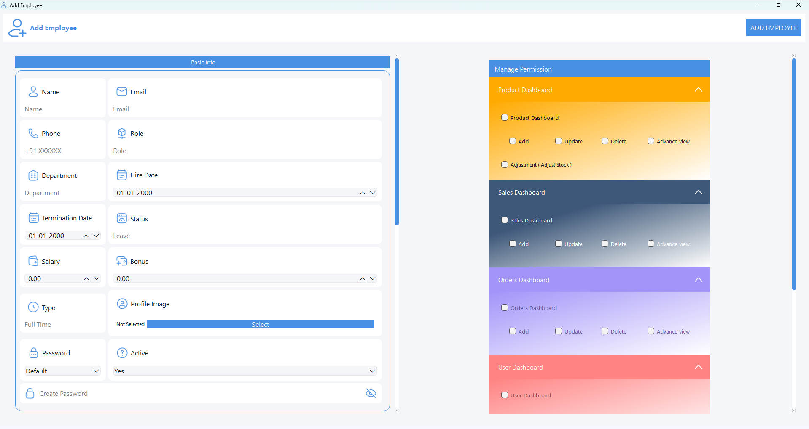
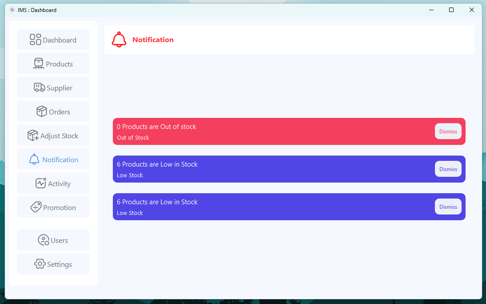

---

# 🏪 Inventory Management System (IMS)

> A modern, secure, and modular Inventory Management System built using Qt C++.

<p align="left">
  
  
  
  
  
  
  
  
  
    
</p>

[](https://github.com/arshc0der/Inventory-Management-System/commits/main)

<p align="center">
  
</p>

## 📥 **Download Stable Version**

**For the most secure and verified download experience, please use the official Microsoft Store.**

<!-- Microsoft Store Badge for Download -->
<a href="https://apps.microsoft.com/detail/9p0jjx40lsk5?referrer=appbadge&mode=direct">
	
</a>

## 📌 Overview

IMS is a **powerful** and **secure** desktop inventory management system tailored for small-to-medium businesses. It simplifies stock tracking, order processing, sales, and employee roles — all via a **clean Qt C++ GUI**.

---

## ✨ Features

### 🖥 Core Modules

* ✅ **Dashboard** – Centralized inventory overview
* ✅ **Product Management** – Add, update, delete & track products
* ✅ **Sales & Orders** – Process transactions and manage customers
* ✅ **Stock Adjustments** – Record damage, returns, and stock changes
* ✅ **User Management** – Role-based permissions & user creation
* ✅ **Promotions** – Manage discounts and offers
* ✅ **Activity Logs & Notifications** – Stay updated in real-time
* ✅ **Secure Login** – SHA-256 password hashing

---

## 🎨 UI Upgrade (Enterprise Design Layer)

IBM Carbon-inspired light/dark themes, page transitions, animated KPIs, a **Ctrl+K command palette**,
an **Inventory Explorer** (search / filter / sort / CSV export) and toast notifications.
See [UI_UPGRADE.md](UI_UPGRADE.md) for details.

---

## 🛡️ Tech Stack

* **Language:** C++
* **Framework:** Qt 6 (Widgets)
* **Database:** SQLite
* **Security:** SHA-256 Authentication
* **Platform:** Windows

---

## 🖼️ UI Previews

| Screen         | Preview                                                                                                                |
| -------------- | ---------------------------------------------------------------------------------------------------------------------- |
| Sign In        |       |
| Register       |      |
| Dashboard      |     |
| Products       |      |
| Add Product    |           |
| Update Product |        |
| Delete Product |        |
| Add Employee   |  |
| Notifications  |  |

---

## 🛠 Installation

### 🔹 Windows (Recommended)

1. 📦 Download `IMS_Setup.exe` from the [Releases Page](https://github.com/arshc0der/Inventory-Management-System/releases)
2. 🚀 Run the installer
3. 🎉 Launch from desktop/start menu

### 🔹 Developer Setup (Manual Build)

```bash
git clone https://github.com/arshc0der/Inventory-Management-System.git
cd Inventory-Management-System
```

> 📌 Requires **Qt 6** and compiler for C++ (e.g., MSVC or MinGW)

---

## 🚧 Known Issues

* ⚠️ This is a **Beta release** – expect occasional bugs
* 🛠️ Under active development
* 🐛 Found something? Submit to [GitHub Issues](https://github.com/arshc0der/Inventory-Management-System/issues)

---

## 🙌 Contributing

Contributions are welcome! Here's how:

* 🍴 Fork the repository
* 🛠 Make your changes
* 📬 Submit a pull request
* ⭐ Star the repo to support the project

---

## 📢 Stay Connected

* 💻 Follow **[@arshc0der](https://github.com/arshc0der)** on Github
* 📬 Get updates on new features & releases
* 💬 Share feedback via Issues or Discussions

---

## 📜 License

Licensed under the [MIT License](LICENSE).
© 2025 [Arshc0der](https://github.com/arshc0der)

---

